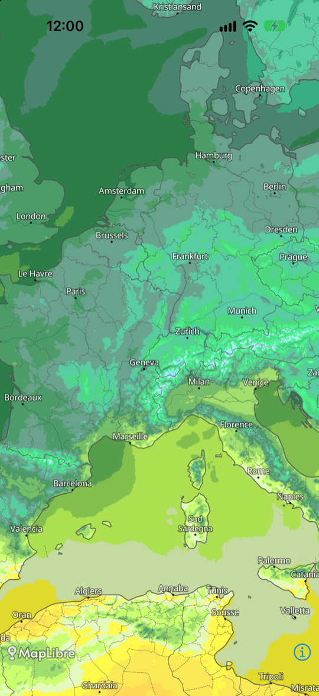

# meteoblue Maps API – iOS MapLibre example

A minimal iOS app (SwiftUI) that shows a meteoblue temperature forecast map using
[MapLibre Native iOS](https://github.com/maplibre/maplibre-native).

All relevant code is in [`MapView.swift`](MapsAPIMapLibre/MapView.swift):

1. **Background map**: the meteoblue map style `https://maps-api.meteoblue.com/mapstyle/weathermap`
2. **Time API**: `https://maps-api.meteoblue.com/v1/time/hourly/{domain}` returns the current time step
3. **Tile API**: raster tiles from `https://maps-api.meteoblue.com/v1/map/raster/{domain}/{time}/{layer}/{z}/{x}/{y}`
   are added as a MapLibre raster layer below the labels of the background map

## Run

Open `MapsAPIMapLibre.xcodeproj` in Xcode and run the `MapsAPIMapLibre` scheme.
MapLibre is added via Swift Package Manager and is fetched automatically.
To run on a device, select your development team under *Signing & Capabilities*.

## API key

The app uses a rate-limited demo API key, which will be replaced from time to time.
Get your own API key [here](https://content.meteoblue.com/en/access-options/meteoblue-weather-api)
and set `apiKey` in `MapView.swift`.

## Variants

|         | MapLibre                            | WebView + Maps Plugin              |
| ------- | ----------------------------------- | ---------------------------------- |
| Android | `maps-api-android-maplibre-example` | `maps-api-android-webview-example` |
| iOS     | `maps-api-ios-maplibre-example`     | `maps-api-ios-webview-example`     |

## Documentation

- [Maps API overview](https://docs.meteoblue.com/en/weather-apis/maps-api/overview)
- [Time API](https://docs.meteoblue.com/en/weather-apis/maps-api/time-api)
- [Tile API](https://docs.meteoblue.com/en/weather-apis/maps-api/tile-api)
- [Domains and weather variables](https://docs.meteoblue.com/en/weather-apis/maps-api/domains)
- [Web examples (Mapbox GL JS, Leaflet)](https://docs.meteoblue.com/en/weather-apis/maps-api/examples)
